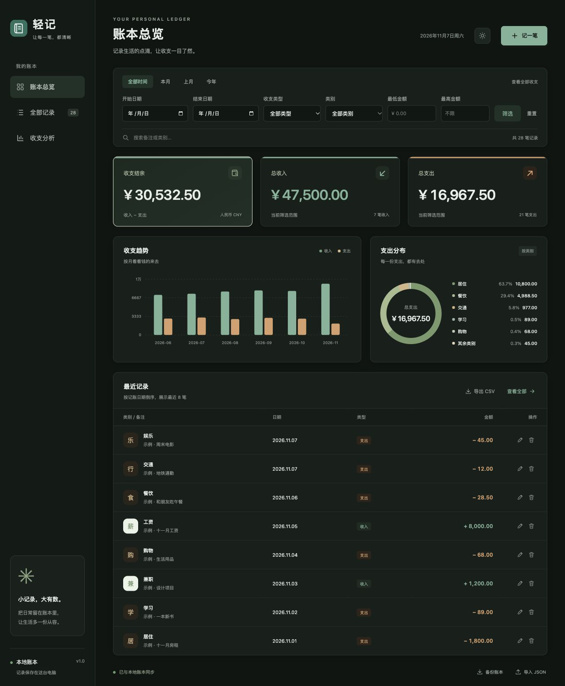
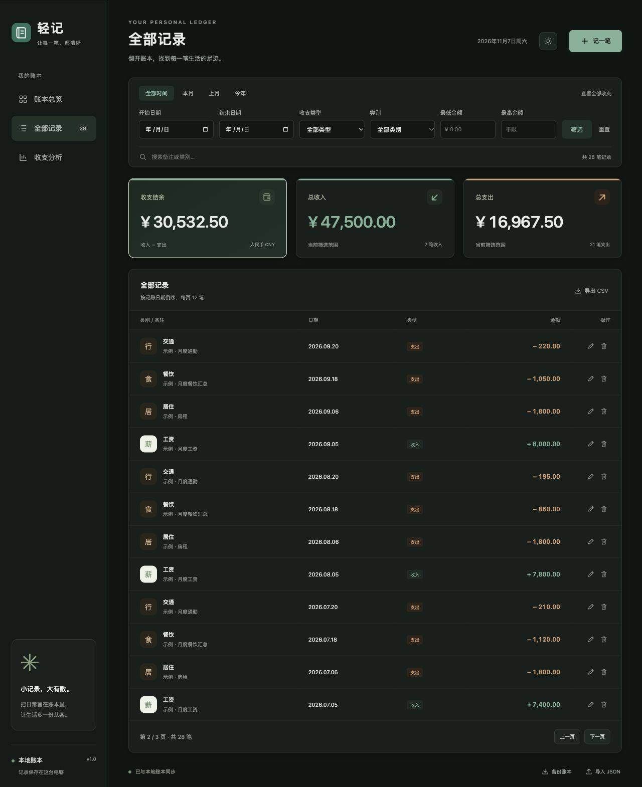
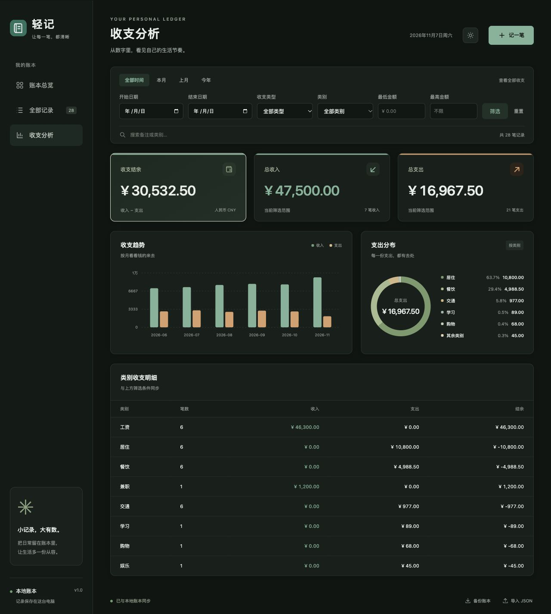

# D3 · 前端交互与可视化验证

- 对应成员：戴锴斌（GitHub：dkb0704）。
- 提交来源：团队提供的 `qingji.zip` 中的 `static/app.js`，原样提交。
- 范围：D3 前端交互与可视化，附本次联调截图；未修改后端模块及 D2 页面结构、样式。
- 验证日期：2026-11-07；环境为 macOS、Python 3.9.6、本机浏览器。

## 功能范围

包括 dashboard 请求、三种视图切换、收支与记录渲染、分页、日期/金额/类别/关键词筛选、新增与编辑弹窗、删除确认、JSON 导入导出、CSV 下载、月度柱状图、类别环形图、分类明细、金额动画以及明暗主题保存。

## 验证结果

- `node --check static/app.js`：通过。
- `python3 -m unittest discover -s tests -v`：团队现有 29 项测试通过。
- 使用独立临时账本载入仓库中的 28 笔虚构示例记录。总收入为 47,500.00 元，总支出为 16,967.50 元，结余为 30,532.50 元。
- 总览显示最近 8 笔；全部记录能切换到第 2 / 3 页；分析页显示各类别收入、支出与结余。
- 新增 19.80 元临时餐饮记录后显示 29 笔；编辑为 20.00 元，最低/最高金额均为 20 时能筛出该条记录。
- 删除确认后筛选结果为 0；重置筛选后恢复为原有 28 笔。
- 明暗主题按钮能切换主题，刷新页面后保持所选主题。
- 本次已执行操作未出现浏览器控制台错误。导入导出由现有接口测试覆盖，本次未重复进行文件选择器和下载的浏览器操作。
- 截图全部采用虚构示例记录，临时账本、锁文件及缓存不纳入提交。

## 界面截图

### 总览与图表

### 全部记录与分页

### 收支分析

### 暗色主题

